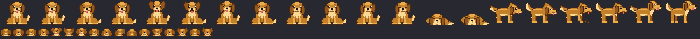

# doggo

A pixel-art golden retriever that keeps you company in Claude Code. It sniffs
the files Claude reads, digs when it edits, fetches your shell commands, tilts
its head when Claude asks permission, looks worried when a tool fails, and
falls asleep when you wander off. Pet it, feed it, and it remembers you
between sessions.



## Requirements

- **Claude Code 2.1.287 or later** (tested on 2.1.296). Check with `claude --version`.
- **A truecolor terminal** for the sprite (Ghostty, kitty, iTerm2, WezTerm).
  The Claude Desktop app shows a one-line text version instead.
- **Python 3 + Pillow**, only if you want to redraw the art.

Mods are code that runs with your permissions inside Claude Code. Read
`hooks/` before installing if you didn't write it.

## Install

### From GitHub (recommended)

At the Claude Code prompt:

```
/plugin install doggo --marketplace ssilve1989/claude-code-doggos
```

Answer `y` to add the marketplace, then pick a scope (user scope loads it in
every project). Or from your shell:

```sh
claude plugin marketplace add ssilve1989/claude-code-doggos
claude plugin install doggo@doggos
```

If a session is already open, run `/reload-plugins` there.

To get a newer version later:

```sh
claude plugin update doggo@doggos
```

then `/reload-plugins` in any open session.

### From a local clone (for development)

Clone the repo somewhere permanent. Both options below read the plugin from
that folder, so moving or deleting it stops the dog loading.

```sh
git clone git@github.com:ssilve1989/claude-code-doggos.git ~/dev/claude-mods/doggos
```

**Try it for one session.** Nothing is installed, and the session hot-reloads
the mod whenever you save a file in the folder:

```sh
claude --plugin-dir ~/dev/claude-mods/doggos
```

**Install it for every session.** The repo is its own marketplace
(`.claude-plugin/marketplace.json`), so it can be added as a local one:

```sh
claude plugin marketplace add ~/dev/claude-mods/doggos
claude plugin install doggo@doggos
```

Because that marketplace is a local folder, the installed mod reads your
folder directly. After editing the code, run `/reload-plugins`; no reinstall
or version bump is needed. Use either the GitHub or the local marketplace, not
both: they share the name `doggos`.

### Check that it loaded

Run `/plugin` at the Claude Code prompt. A dim line under the tabs should read
`1 mod active · doggo` (the count includes any other mods you run). The
dog appears above the prompt with a greeting.

## Setup

Options, settable in `/config` (look for the `doggo` rows), or with
`/plugin configure doggo@doggos`:

| Option | Values | Default |
|---|---|---|
| `display` | `band` (above the prompt), `pane` (beside the transcript), `off` | `band` |
| `name` | any name | `Biscuit` |
| `barkAfterSeconds` | turns at least this long send a notification | `60` |
| `breakAfterMinutes` | work streak before the break reminder | `90` |
| `spinner` | swap Claude's spinner word for the dog's | `true` |

Changes made with `/doggo band|pane|off` or `/doggo name <name>` are saved
and take precedence over these options from then on.

The pane opens beside the transcript in a wide fullscreen terminal and above
the prompt otherwise. It needs 48 columns for the big sprite and falls back to
the small one below that.

## What it notices

- **Context:** past 70% of the context window the dog gets drowsy; past 90%
  it pants and suggests `/compact` once. After a compaction it shakes off.
- **Long waits:** when Claude has been busy for 2 minutes with nothing new to
  show, the dog lies down to wait.
- **Milestones:** passing tests (npm/pnpm/yarn/bun test, vitest, jest, pytest,
  go test, cargo test, claude plugin test) set off the zoomies; failing ones
  get sad ears. A successful `git commit` or `git push` is celebrated.

Changes of pose are animated: the dog stands, sits, turns and lies down
through in-between frames instead of cutting between poses.

## Nudges

- **Done bark:** a turn that runs for `barkAfterSeconds` or more sends a native
  notification ("Claude's done! 🐾"). Aborted turns and subagents stay quiet.
- **Waiting bark:** if Claude has been waiting on your permission for 30
  seconds, you get "Claude needs you!".
- **Break reminders:** after `breakAfterMinutes` of steady work (no gap longer
  than 15 minutes) the dog brings its leash, and again every 30 minutes.
- **Night owl:** between midnight and 5 am it yawns at your prompts (once an
  hour) and dozes off after 2 quiet minutes instead of 10.
- **Dog spinner:** Claude's spinner reads Sniffing, Digging, Fetching,
  Pondering, Wagging or Woofing. The Desktop app keeps its own.

Notifications use your terminal's notification channel (Claude Code's
`preferredNotifChannel` setting). If that's off, the dog still reacts on screen.

## Commands

| Command | What it does |
|---|---|
| `/doggo` | toggle the pane (big sprite + stats) |
| `/doggo pet` | pet the dog (bond +1, counts 5 times per session) |
| `/doggo treat` | give a treat (bond +2; the 4th in a session is refused) |
| `/doggo band` / `pane` / `off` | move or hide the dog |
| `/doggo name <name>` | rename the dog |

In the pane, `p` pets and `t` gives a treat while the pane has focus
(Ctrl+X then Tab, or click it). `Esc` returns focus to the prompt.

## Memory

The dog's name, bond, stats and display choice live in the mod's store, a
JSON file under `~/.claude/plugins/store/`. Every session on your machine
shares it. Delete that file to start over with a dog who has never met you.

## Uninstall

```sh
claude plugin uninstall doggo@doggos
claude plugin marketplace remove doggos
```

To pause it without uninstalling, disable it in `/plugin` → **Installed**, or
start a session with `--safe-mode`.

## Troubleshooting

- **No dog, no `mods active` line:** check `claude --version`, and that
  `disableAllHooks` isn't set in `~/.claude/settings.json`. Organization
  policies can also block user-installed mods.
- **Mod loads but nothing draws:** start with `claude --debug` and look for
  lines starting `doggo:`. With `--plugin-dir` the same lines also show in the
  transcript.
- **Blocky or wrong colours:** the terminal isn't truecolor. Check
  `echo $COLORTERM` prints `truecolor`.
- **Dog only shows as text:** the band is narrower than 16 columns or shorter
  than 6 rows, or you're in the Desktop app.

## Development

```sh
pnpm install              # dev tooling only: commit hooks (the mod needs no install)
claude plugin test        # unit + integration tests, no session needed
claude plugin validate .  # what Claude Code reads from the mod
tsc -p .                  # type-check (types land in .claude-plugin/types/ once the mod has loaded)
python3 art/build.py      # redraw sprites -> hooks/sprites.ts and art/preview.png
```

`hooks/mood.ts`, `hooks/bond.ts` and `hooks/raster.ts` are pure logic;
`hooks/register.tsx` wires them to Claude Code's events. `hooks/sprites.ts` is
generated, so edit `art/build.py` instead. Design notes are in
`docs/superpowers/specs/`.

### Commits and releases

Commit messages follow [Conventional Commits](https://www.conventionalcommits.org/)
(`feat:`, `fix:`, `docs:`, `chore:`…). `pnpm install` sets up a `commit-msg`
hook that rejects anything else, and CI lints every commit in a pull request.

Releases are automated by [release-please](https://github.com/googleapis/release-please):
each push to `main` updates a release PR with the next version, the
`CHANGELOG.md` entry and the version in `.claude-plugin/plugin.json`. Merging
that PR tags the release, and `claude plugin update doggo@doggos` then picks
it up. While the version is below 1.0, `feat` bumps the minor version and
`fix` the patch.

## License

MIT. See [LICENSE.md](LICENSE.md).
